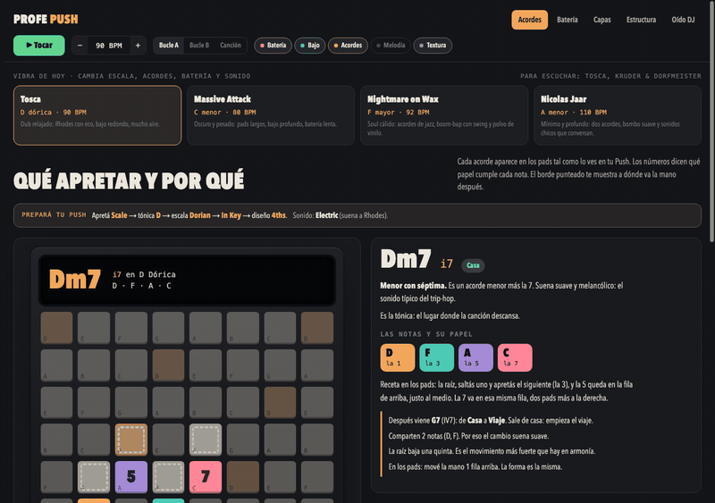

# Profe Push: a music class to practise with a Push 3 in your hands

One HTML page that draws an Ableton Push 3 on screen and teaches with it: which pads to press, and why.

[](https://re4mat-mp.github.io/profe-push/)

**▶ [Open the class](https://re4mat-mp.github.io/profe-push/clase/)** · [the start page](https://re4mat-mp.github.io/profe-push/) · in Spanish, with sound, works on a phone

I play with a Push 3 and Ableton Live, and I made this with Claude to learn my own instrument. It is a practice
page, not a product: you keep the Push on your lap and the page next to it.

> **In three sentences.** The class has five rooms: chords drawn on the pads with every note numbered, eight drum
> styles as patterns and pads, layers that stack into a track, a song map that turns a loop into a song, and four DJ
> ear games. Four moods change the key, the tempo, the drums and the sound in one click, each named after the artists
> it points at. Every sound is synthesised in the browser with the Web Audio API, so there are no samples and nothing
> to download.

## What's in it

| File | What it is |
|---|---|
| [`clase/index.html`](clase/index.html) | **The class.** One self-contained file of HTML, CSS and JavaScript, about 100 KB. Open it and play. |
| [`index.html`](index.html) | The start page. |
| [`media/`](media/) | The GIF above and the start page's pictures, all taken from the class itself. |

## The five rooms

1. **Acordes.** Each chord of the scale on the 8×8 pads, laid out the way the Push shows them in Scale mode with the
   4ths layout. The notes are numbered 1, 3, 5 and 7, a dashed outline shows where the hand goes for the next chord,
   and a chord map sorts the seven chords into home, journey and tension.
2. **Batería.** Trip-hop, dub, boom-bap, minimal, house, techno, drum & bass and jungle, each as a two-bar pattern you
   can click to change, and as the exact pads to light in drum mode.
3. **Capas.** Drums, bass, chords, melody and texture, each on its own track, switched on and off to hear what it adds.
4. **Estructura.** Intro, verse, chorus, break, chorus, outro: the same layers in a different mix, and how to lay that
   out as scenes in Session view.
5. **Oído DJ.** Four games, best with headphones: which record is ahead, which is faster, match the tempo with the
   pitch, and keep the beat.

With a Push plugged in by USB, Chrome and Edge can listen to it through Web MIDI, name the chord you are holding, and tell you whether it is the one on screen.
Safari has no Web MIDI, so there the class works without it.

## For this public copy

- The original page loaded two web fonts. This copy uses the fonts already on your device, so it makes no outside
  requests.
- It got a start page in the portfolio's style and a way back to it. The class itself, its words and its sound are
  unchanged.

## Run it locally

```bash
git clone https://github.com/re4mat-mp/profe-push && cd profe-push
open clase/index.html          # Linux: xdg-open, Windows: start
```

No build step and no server needed.

---

<sub>Not affiliated with Ableton. Push and Live are Ableton's names. The artists named in the moods (Tosca, Kruder &
Dorfmeister, Massive Attack, Portishead, Nightmare on Wax, DJ Cam, Nicolas Jaar, Darkside) are only pointers to a
sound; no music of theirs is used.</sub>

<sub>[← All the pieces](https://re4mat-mp.github.io/)</sub>
